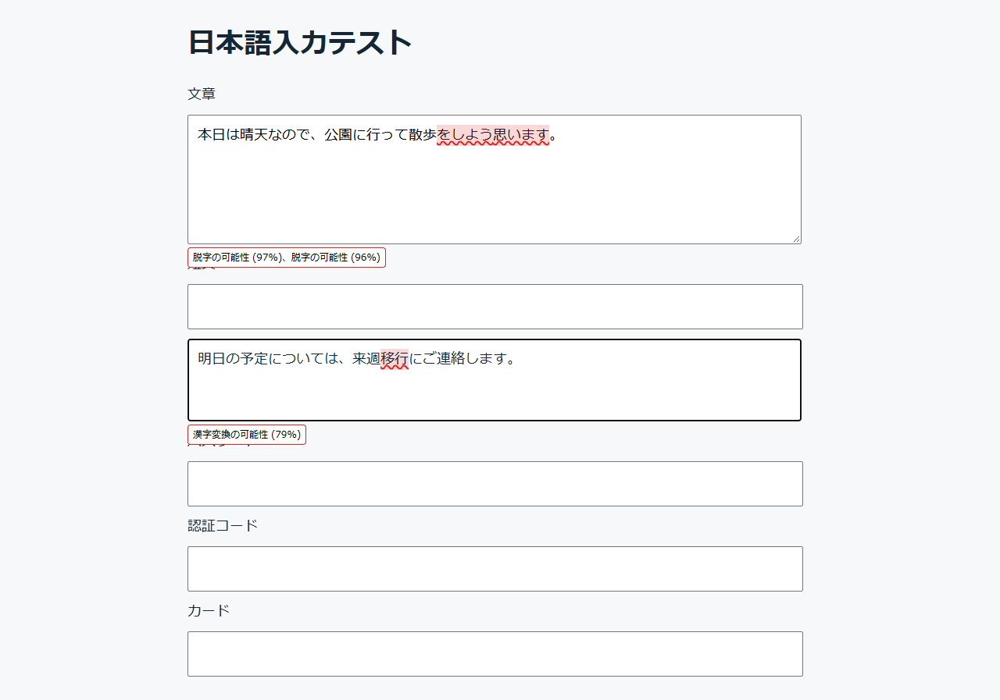
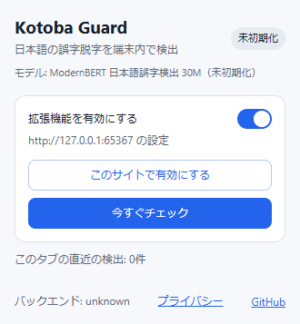

# Kotoba Guard

[日本語](README.md) · [Documentation index](docs/index.md)

The default developer build uses the older QUInt8 model path. Use the [isolated preview procedure](docs/release.md#ローカルpreviewの作成) for the current preview.

[v0.1.0 preview](https://github.com/ayutaz/kotoba-guard/releases/tag/v0.1.0) is available as an unpacked extension ZIP with the model and WASM bundled. The [release validation record](docs/validation-v0.1.0.md) identifies the tested source, hashes, real-model E2E, traffic audit and Windows/Linux CI results.

Kotoba Guard is a Chrome extension for detecting Japanese typos in the browser. It bundles the model and inference runtime with the extension and processes input locally.

**This is a preview. Formal MVP acceptance remains incomplete.** Offline manual/automatic checks and generic editors are tested. Physical IME, native permission UI, real services and all-platform validation remain incomplete.

The latest tested preview source is `f2d6afdd5bd241a5bed30b77faef226702f09cd2`. It bundles a 48,188,514-byte model with UINT8 embeddings, FLOAT16 MatMul weight storage and FLOAT computation. CPU/WASM parity passed on 64 fixed examples; the 128-token p50 of 150.1ms missed the 100ms target, and general accuracy of this variant is unmeasured. It was integrated into a development preview after optimization was deferred. Formal MVP/M5 acceptance remains incomplete.

The extracted public ZIP passed seven E2E tests (four mock, three real-model) and its traffic audit, including zero unexpected requests, monitoring coverage, asset binding and cleanup. Historical failures and source bindings remain in [preview validation](docs/preview-validation.md).

The images below are historical local-fixture examples, not new captures of the latest preview.





## Install the preview

Download the extension ZIP from [GitHub Releases](https://github.com/ayutaz/kotoba-guard/releases). This is not a Chrome Web Store distribution.

1. Extract the ZIP into a local folder.
2. Open `chrome://extensions` and enable Developer mode.
3. Select **Load unpacked** and choose the extracted folder.
4. Focus an editor and select the extension's manual check action.
5. Enable automatic checks only for sites you explicitly allow.

For updates, extract the new ZIP and update the loaded extension directory. Review detections yourself: false positives and missed errors remain possible.

## Current architecture

```text
permitted editor
  -> Content Script / Editor Adapter
  -> Service Worker
  -> Offscreen Document / Worker
  -> browser inference SDK
  -> ONNX Runtime Web (WASM)
  -> Japanese ModernBERT typo detector
```

The SDK is independent of Chrome APIs, and label definitions are read from the upstream configuration. Detection spans use JavaScript UTF-16 half-open ranges. The extension displays results without rewriting the editor's value or editable DOM. See [docs/architecture.md](docs/architecture.md) and the [documentation index](docs/index.md).

## Scope and validation status

Implemented features include ordinary `textarea`, text `input`, and `contenteditable` editors, post-composition IME handling, explicit per-site permission, sensitive-field exclusion, WASM inference, and offline operation. Composition events have been tested; physical IME and Chrome's native permission UI acceptance remain open. WebGPU controls, correction suggestions, and high-accuracy modes are not implemented. Production services such as Gmail, ChatGPT, and X remain unverified. A passing local editor fixture does not prove behavior on a production service.

Playwright tests use local fixtures and are kept separate from real-model validation. WASM success does not prove WebGPU behavior. See [docs/browser-compatibility.md](docs/browser-compatibility.md), [docs/research/competitors.md](docs/research/competitors.md), and [docs/research/browser-platform.md](docs/research/browser-platform.md).

## Development environment

- Node.js 24 LTS, Python 3.12, and uv are used on Windows.
- Python dependencies are locked by `pyproject.toml` and `uv.lock`; do not use `pip install` or a global Python environment.
- Node dependencies are locked by `package-lock.json`.
- Isolated Linux Docker passed all ten gates at source `0dc814c`: 297 Python tests, 234 TypeScript tests, five real-model E2E tests, conversion comparison, build, and ZIP verification. The same source passed all ten Windows gates and nine E2E tests. These are local checks, separate from remote GitHub Actions.

```powershell
uv sync --locked
npm ci
uv run --locked python scripts/harness/check_environment.py
npm run check
npm test
```

## Build and load the unpacked extension

Converted model artifacts are excluded from normal Git history. The following commands download the pinned Hugging Face revision into the development workspace, run reference inference, export ONNX, create INT8/FP16 variants, and write the manifest. The download is an explicit developer build step; the installed extension does not fetch models or code at runtime.

```powershell
uv sync --locked
npm ci
uv run --locked python scripts/model_pipeline.py download
uv run --locked python scripts/model_pipeline.py reference --text "明日の予定については、来週移行にご連絡します。"
uv run --locked python scripts/model_pipeline.py export
uv run --locked python scripts/model_pipeline.py convert
uv run --locked python scripts/model_pipeline.py manifest
npm run build
```

After generating the model, verify the package. For browser fixtures, install Chromium once and run the E2E suite.

```powershell
npx playwright install chromium
npm run test:e2e
npm run package
```

The `manifest` command also copies upstream config, tokenizer, LICENSE, and README files into the converted directory and records asset hashes. The build creates a separate distribution model with private debug paths removed.

Open `dist/extension` from `chrome://extensions` with Developer mode enabled, using **Load unpacked**. A build without model artifacts is a development-only build; it does not demonstrate package verification or real-model inference.

Focus an editor and choose the popup's manual-check button for a single check. For automatic checks, enable the current site and confirm Chrome's access request. Detection waits 400ms after composition commits. Marks indicate possible errors without automatic corrections; the detection-count button opens the details. Editor value, editable DOM, selection preservation, and fixture Undo/Redo have been tested, while complete interaction testing including physical IME remains open. The site button disables that site; the global switch stops all checks. Suggestions, dictionaries, and a dedicated settings page are not implemented.

## Model

The upstream model is SB Intuitions' [`ja-typo-detector-modernbert-ja-base-30m`](https://huggingface.co/sbintuitions/ja-typo-detector-modernbert-ja-base-30m).

- Pinned revision: `8d640720bddeb64c89dc1fa7780c3ea29fa523e8`
- Task: token classification
- Labels: read from the upstream `config.json` `id2label` / `label2id` mappings
- License: MIT, as recorded in the upstream model card

This repository did not train the model. It provides conversion, browser integration, and validation. The detector does not generate correction text, so correction candidates are not presented as model output. Conversion metadata, SHA-256 values, and runtime versions are recorded in the generated manifest; see [models/README.md](models/README.md) and [docs/development.md](docs/development.md).

## Privacy and permissions

The implementation has these boundaries:

- Input text, inference results, and debug logs are not sent outside the extension.
- No telemetry, account, API key, or persistent storage of input text is required.
- The model, tokenizer, JavaScript, and WASM are bundled with the extension.
- Password, payment, one-time-code, hidden, and file inputs are excluded from detection.
- The extension does not request default access to every site; only user-permitted sites are targeted.
- CSP and message validation are used, and input text is never inserted as HTML.

See [PRIVACY.md](PRIVACY.md), [SECURITY.md](SECURITY.md), [docs/security-design.md](docs/security-design.md), and [docs/threat-model.md](docs/threat-model.md). Local fixtures passed offline first inference with zero requests in the monitored scope. After the cleanup fix, the audit verified coverage of the selected extension contexts and completed successfully. Browser UI, pre-monitoring bootstrap and untested paths remain outside that evidence. See the [security validation record](docs/security-report.md) for monitoring and dependency audit scope.

## Benchmarks and limitations

The current FP16-storage model is 48,188,514 bytes. At source `2914a68`, Windows11 / Chromium159 / single-threaded WASM, 128 tokens, three warmups and 20 samples measured p50=150.1ms and p95=200.5ms. This is direct ORT inference excluding initialization and UI; the 100ms p50 target was missed. The preview bundles the same model SHA. No new general-corpus accuracy or long-term memory measurement was performed.

The older QUInt8 model's 37,789,676-byte size and p50=90.6ms/p95=108.6ms are historical measurements of a different model. On 10,872 accepted JWTD official-test examples, reference precision/recall were 74.57%/63.32% with 8.63% clean false positives; old QUInt8 measured 74.15%/62.07% and 8.44%. Accuracy targets were unmet. These are not accuracy results for the latest preview. See [benchmarks](docs/benchmarks.md) for model-specific conditions and scope.

Known limitations include unavailable WebGPU controls in the normal UI; unverified Edge, Firefox, mobile, cross-origin iframe, closed Shadow DOM, and Google Docs support; service-specific editor behavior; and the CPU/RAM requirements of model conversion. WebGPU was tested only in the isolated FP16 probe.

## Contributing

Use Red -> Green -> Refactor, then run the relevant unit, integration, E2E, and security checks. Do not add model or generated artifacts to normal Git history. Keep measured results separate from unverified items and update the documentation with behavior changes. See [AGENTS.md](AGENTS.md), [CONTRIBUTING.md](CONTRIBUTING.md), and [docs/roadmap.md](docs/roadmap.md).

## License and credit

Project code is provided under the [MIT License](LICENSE). Copyright and licensing for the upstream model belong to SB Intuitions and the upstream model card. Dependency and third-party notices are collected in [THIRD_PARTY_NOTICES.md](THIRD_PARTY_NOTICES.md).

The [GitHub v0.1.0 preview](https://github.com/ayutaz/kotoba-guard/releases/tag/v0.1.0) is available. There is no Chrome Web Store listing, npm package or Hugging Face publication.
