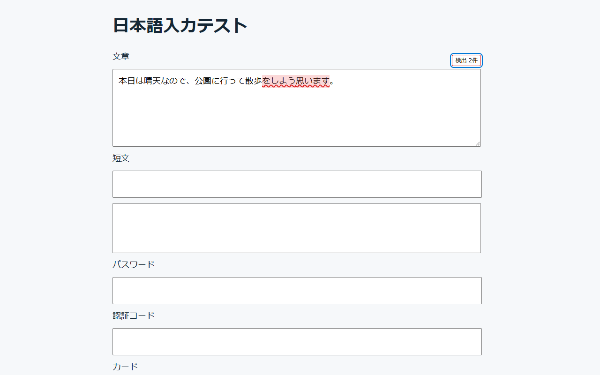

# Kotoba Guard

**A Chrome extension that checks Japanese text for typos entirely on your PC.**

Kotoba Guard marks possible errors as you write. Your text stays on your device, and checks work offline after installation. It is free and open source, with no account or API key required.

[Download the preview](https://github.com/ayutaz/kotoba-guard/releases/tag/v0.1.0) · [How to use it](#how-to-use-it) · [日本語](README.md)



_A local test page running v0.1.0. Possible errors are marked without rewriting the text._

The current release is **v0.1.0, a preview distributed on GitHub**. It is not yet on the Chrome Web Store. False positives and missed errors are possible, so please review the results yourself.

## What you can do

- **Check on demand:** check an editor's text whenever you choose.
- **Check automatically:** on sites you allow, checks run after typing or Japanese text conversion is committed.
- **Review possible errors:** highlights and a results list show the error type and confidence.
- **Choose sites:** turn automatic checking on or off for each site.

The AI model is bundled with the extension and runs on the CPU, so a GPU is not required. Correction suggestions and automatic corrections are not yet available.

## Install the preview

1. Download **`kotoba-guard-0.1.0.zip`** from the [v0.1.0 release page](https://github.com/ayutaz/kotoba-guard/releases/tag/v0.1.0).
2. Extract the ZIP into a folder. Keep this folder while using the extension.
3. Open `chrome://extensions` in Chrome and turn on **Developer mode** in the top right.
4. Click **Load unpacked** and select the extracted folder.

The ZIP is about 63 MB because it includes the AI model. You do not need to download the model separately or set up a development environment.

## How to use it

1. Click the text field you want to check.
2. Open Kotoba Guard from the Chrome toolbar and click **「今すぐチェック」** (Check now).
3. Possible errors will be marked. Click **「検出 N件」** (N detections) to see the details.

To enable automatic checks, click **「このサイトで有効にする」** (Enable on this site) in the extension and review Chrome's access request. Checks wait until Japanese text conversion is committed, then run after a short delay. The current interface is in Japanese.

You can disable automatic checks for individual sites. Turn off the extension's enable switch to stop all checks.

## Support and limitations

Kotoba Guard targets ordinary text fields, multiline text areas, and editable text on web pages. Detection with the real model and offline operation have been verified on local test pages.

- **Individual services such as Gmail, ChatGPT, X, and Google Docs remain unverified.**
- Japanese composition event handling is tested; interaction testing with an actual IME is still pending.
- Chrome is the target browser. Other browsers and mobile devices have not been verified.
- General-text accuracy evaluation of the currently bundled model is incomplete. It may miss errors or flag correct expressions.

See the [preview validation record](docs/validation-v0.1.0.md) for verified checks and open issues, and [benchmarks](docs/benchmarks.md) for measured performance.

## Privacy

Checks run entirely on your PC. Input text is not sent outside the extension, written to logs, or saved to persistent storage. There is no telemetry. Automatic checking only accesses sites you explicitly allow.

Sensitive fields identified by their attributes, such as passwords, credit cards, and authentication codes, are excluded. Fields without appropriate attributes cannot always be identified as sensitive.

Read the [privacy policy](PRIVACY.md) and [security policy](SECURITY.md) for details.

## Feedback and bug reports

Share your experience or report problems through [GitHub Issues](https://github.com/ayutaz/kotoba-guard/issues). The site, editor type, and steps to reproduce help us investigate. Remove personal and confidential information from any text or screenshots you post.

## Contributing

Development uses Node.js 24 LTS, Python 3.12, and uv. Install dependencies and run basic code checks with:

```powershell
uv sync --locked
npm ci
npm run check
npm test
```

Model preparation and extension builds require additional steps. See the following guides, which are primarily in Japanese:

- [Development and testing](docs/development.md) / [Contributing guide](CONTRIBUTING.md)
- [Architecture](docs/architecture.md)
- [Model conversion](docs/model-conversion.md) / [Model card](docs/model-card.md)
- [Reproducing the distribution](docs/release.md#ローカルpreviewの作成)
- [Documentation index](docs/index.md)

## License and credit

The code is released under the [MIT License](LICENSE).

Typo detection uses SB Intuitions' Japanese model, [`ja-typo-detector-modernbert-ja-base-30m`](https://huggingface.co/sbintuitions/ja-typo-detector-modernbert-ja-base-30m), licensed under MIT. Kotoba Guard provides model conversion and browser integration.

See [third-party notices](THIRD_PARTY_NOTICES.md) for dependency licenses and credits.
