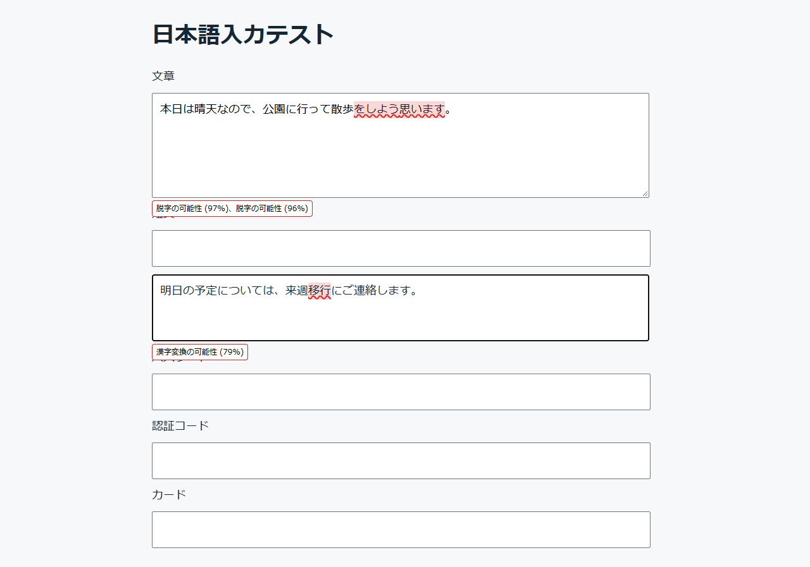
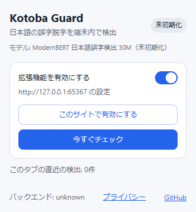

# Kotoba Guard

[English](README.en.md) · [文書索引](docs/index.md)

開発者向けの既定buildは旧QUInt8モデル経路です。現在のpreviewを再現する場合は[隔離preview手順](docs/release.md#ローカルpreviewの作成)を使います。

[v0.1.0プレビュー](https://github.com/ayutaz/kotoba-guard/releases/tag/v0.1.0)を公開しました。モデルとWASMを同梱したZIPを展開して利用できます。[公開・検証記録](docs/validation-v0.1.0.md)に、検証ソース、SHA、実モデルE2E、通信監査、Windows/Linux CIの結果を記録しています。

Kotoba Guard は、ブラウザ内で日本語の誤字脱字を検出する Chrome 拡張機能です。入力本文を外部サービスへ送らず、モデルと推論ランタイムを拡張機能に同梱しています。

**現在はプレビュー版です。正式MVPの受け入れ条件は未達です。** オフラインの手動・自動チェックと一般編集欄を検証しています。物理IME・ネイティブ権限UI・実サービス・全環境での動作保証は未完了です。

最新previewの検証ソースは`f2d6afdd5bd241a5bed30b77faef226702f09cd2`です。Embedding UINT8 / MatMul FP16保存・FLOAT演算の48,188,514-byteモデルを同梱しています。固定64例のCPU/WASM一致は成功しましたが、128-token p50=150.1msの100ms目標未達と、一般精度未評価は残っています。最適化延期の方針で開発previewへ統合し、正式MVP/M5の合格とはしていません。

公開ZIPを展開し、mock4件＋実モデル3件のE2Eと通信監査に成功しました。予期しない通信0、観測網羅性、資産照合、終了処理を確認しました。過去の失敗・対象ソースは[preview検証](docs/preview-validation.md)に保持しています。

以下の画像は過去のローカルfixtureで撮影した参考画像で、最新previewの新規キャプチャではありません。





## プレビューのインストール

[GitHub Releases](https://github.com/ayutaz/kotoba-guard/releases)から拡張機能ZIPを取得します。Chrome Web Store配布版ではありません。

1. ZIPを任意のフォルダへ展開します。
2. Chromeの `chrome://extensions` でデベロッパーモードを有効にします。
3. 「パッケージ化されていない拡張機能を読み込む」で展開先を選びます。
4. 文章欄にフォーカスし、拡張機能の「今すぐチェック」を選びます。
5. 自動チェックを使うサイトだけ「このサイトで有効にする」から許可します。

更新時は新しいZIPを展開し、拡張機能の読み込み先を更新します。誤検出・見逃しがあるため、結果は利用者が確認してください。

## 現在の構成

```text
許可したエディタ
  → Content Script / Editor Adapter
  → Service Worker
  → Offscreen Document / Worker
  → browser inference SDK
  → ONNX Runtime Web (WASM)
  → ModernBERT 日本語誤字検出モデル
```

SDK は Chrome API から分離し、モデルのラベル定義は設定ファイルから読み込みます。検出位置は JavaScript の UTF-16 半開区間で扱い、入力欄の値や編集 DOM を書き換えずに結果を表示します。実装の詳細は [docs/architecture.md](docs/architecture.md)、文書全体の案内は [docs/index.md](docs/index.md) を参照してください。

## 対象機能と検証範囲

一般的な `textarea`、テキスト用 `input`、`contenteditable`、IME の確定後処理、サイト単位の明示的な許可、機密入力欄の除外、WASM 推論、オフライン動作を実装しています。composition イベントは試験済みですが、物理 IME と Chrome のネイティブ許可 UI の受け入れは残っています。通常 UI の WebGPU、高精度モード、修正候補は未実装、Gmail・ChatGPT・X などの実サービスは未検証です。一般エディタ用の fixture が実サービスでの動作を証明するものではありません。

実サービスへのログインを CI に要求せず、Playwright のローカル fixture と実モデル検証を分けます。WASM の成功は WebGPU の動作を意味しません。ブラウザ互換性の境界は [docs/browser-compatibility.md](docs/browser-compatibility.md)、競合・プラットフォーム調査は [docs/research/competitors.md](docs/research/competitors.md) と [docs/research/browser-platform.md](docs/research/browser-platform.md) にまとめています。

## 開発環境

- Windows では Node.js 24 LTS、Python 3.12、uv を使用します。
- Python の依存関係は `pyproject.toml` と `uv.lock` で管理し、`pip install` やグローバル Python は使用しません。
- Node.js の依存関係は `package-lock.json` で固定します。
- ソース`0dc814c`の隔離Linux Dockerでは、Python297件、TS234件、実モデルE2E5件、変換比較、ビルド・ZIPを含む全10ゲートが成功しました。同じソースのWindows全10ゲート・E2E9件も成功。リモートGitHub Actionsとは別のローカル検証です。

```powershell
uv sync --locked
npm ci
uv run --locked python scripts/harness/check_environment.py
npm run check
npm test
```

## ローカルで unpacked 拡張機能を作る

変換済みモデルは通常の Git 履歴に含めません。次のコマンドで、固定した Hugging Face リビジョンを開発用ディレクトリへ取得し、参照推論、ONNX 変換、INT8/FP16 変換、manifest 作成を順に実行します。`download` は開発者が明示的に実行する取得処理であり、利用者の拡張機能が実行時に外部からモデルやコードを取得する設計ではありません。

```powershell
uv sync --locked
npm ci
uv run --locked python scripts/model_pipeline.py download
uv run --locked python scripts/model_pipeline.py reference --text "明日の予定については、来週移行にご連絡します。"
uv run --locked python scripts/model_pipeline.py export
uv run --locked python scripts/model_pipeline.py convert
uv run --locked python scripts/model_pipeline.py manifest
npm run build
```

モデルを含む配布物の検証には、モデル生成後に `npm run package` を実行します。ブラウザの fixture を使う場合は Chromium を一度導入してから `npm run test:e2e` を実行します。

```powershell
npx playwright install chromium
npm run test:e2e
npm run package
```

`manifest` コマンドは上流のconfig、Tokenizer、LICENSE、READMEも変換先へコピーし、資産のSHAを記録します。buildは配布用モデルのデバッグ情報を除去したコピーを作成します。

生成された `dist/extension` を Chrome の `chrome://extensions` で開き、デベロッパーモードを有効にして「パッケージ化されていない拡張機能を読み込む」から選択します。モデル生成前のビルドは開発用の空モデルビルドであり、配布検証や実モデル推論の成功を意味しません。

文章欄にフォーカスを置き、拡張機能のpopupから「今すぐチェック」を選ぶと、その文章を一度だけ検査します。継続して使うサイトでは「このサイトで有効にする」を選び、Chromeのアクセス許可を確認します。変換中は検査せず、確定後400msの待機を経て検査します。下線と説明は誤りの可能性を示し、本文を自動修正しません。「検出 N件」ボタンから詳細を開けます。本文・編集DOM・選択範囲の保持とfixtureでのUndo/Redoは試験済みですが、物理IMEを含む完全な操作検証は残っています。自動チェックはサイトボタン、全体の停止は有効スイッチで切り替えます。修正候補・辞書・専用設定画面は未実装です。

## モデル

上流モデルには SB Intuitions の [`ja-typo-detector-modernbert-ja-base-30m`](https://huggingface.co/sbintuitions/ja-typo-detector-modernbert-ja-base-30m) を使用します。

- 固定リビジョン: `8d640720bddeb64c89dc1fa7780c3ea29fa523e8`
- タスク: token classification
- ラベル: 上流 `config.json` の `id2label` / `label2id` を使用
- ライセンス: 上流モデルカードで確認した MIT

このリポジトリはモデルを学習したものではなく、変換・ブラウザ実装・検証を提供します。検出モデルの出力から修正文や候補を生成したとは表示しません。変換手順、ファイルの SHA-256、ランタイム情報はモデル生成後の manifest に保存し、[models/README.md](models/README.md) と [docs/development.md](docs/development.md) から参照できるようにします。

## プライバシーと権限

実装では次の境界を設けています。

- 入力本文、推論結果、デバッグログを外部へ送信しません。
- テレメトリー、アカウント、API キー、入力本文の永続保存を要求しません。
- モデル、Tokenizer、JavaScript、WASM は拡張機能に同梱します。
- パスワード、決済情報、ワンタイムコード、hidden/file 入力は検出対象から除外します。
- 全サイトへの常時アクセスを既定で要求せず、ユーザーが許可したサイトだけを対象にします。
- CSP とメッセージ検証を使用し、入力本文を HTML として挿入しません。

拡張機能の権限と脅威モデルは [PRIVACY.md](PRIVACY.md)、[SECURITY.md](SECURITY.md)、[docs/security-design.md](docs/security-design.md)、[docs/threat-model.md](docs/threat-model.md) に記載します。ローカルfixtureで初回オフライン推論と監視対象通信0件を確認しています。監査修正後、対象とした拡張contextの観測網羅性と終了処理の成功を確認しました。browser UI・起動前bootstrap・未検証経路まで含む安全保証ではありません。監視・依存監査の範囲は [検証記録](docs/security-report.md) を参照してください。

## ベンチマークと制約

現在のFP16保存モデルは48,188,514 bytes。source`2914a68`のWindows11 / Chromium159 / WASM1thread、128 tokens、3 warmup・20 samplesでp50=150.1ms・p95=200.5msでした。初期化・UIを除く直接ORT推論時間で、100ms p50目標は未達です。このモデルを同じSHAでpreviewに同梱しました。一般コーパス精度と長期メモリの新たな測定は行っていません。

旧QUInt8モデルの37,789,676 bytes・p50=90.6ms/p95=108.6msは別モデルの過去測定です。JWTD公式test採用10,872例では参照P74.57%/R63.32%・正常文誤検出8.63%、旧QUInt8はP74.15%/R62.07%・8.44%で、精度目標未達です。これらを最新previewの精度として転記しません。[ベンチマーク](docs/benchmarks.md)に各モデル・条件・測定範囲を記載しています。

既知の制約には、通常UIのWebGPU未対応、Edge・Firefox・モバイル・cross-origin iframe・closed Shadow DOM・Google Docs の未検証、実サービスのサイト固有挙動、モデル変換に必要な CPU/RAM があります。WebGPUは隔離したFP16実験でのみ検証しています。

## コントリビューション

変更は Red → Green → Refactor の順に進め、関連する unit/integration/E2E テストとセキュリティ検証を実行してください。モデルや生成物を通常の Git 履歴へ追加せず、実測値と未検証項目を区別してドキュメントを更新します。詳細は [AGENTS.md](AGENTS.md)、[CONTRIBUTING.md](CONTRIBUTING.md)、[docs/roadmap.md](docs/roadmap.md) を参照してください。

## ライセンスとクレジット

本プロジェクトのコードは [MIT License](LICENSE) で提供します。上流モデルの著作権・ライセンスは SB Intuitions と上流モデルカードに帰属します。依存関係と第三者資料の表示は [THIRD_PARTY_NOTICES.md](THIRD_PARTY_NOTICES.md) にまとめます。

GitHubでは[v0.1.0プレビュー](https://github.com/ayutaz/kotoba-guard/releases/tag/v0.1.0)を配布しています。Chrome Web Store、npm、Hugging Faceへの公開は行っていません。
